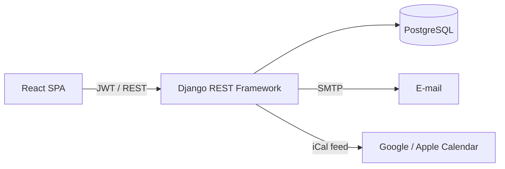
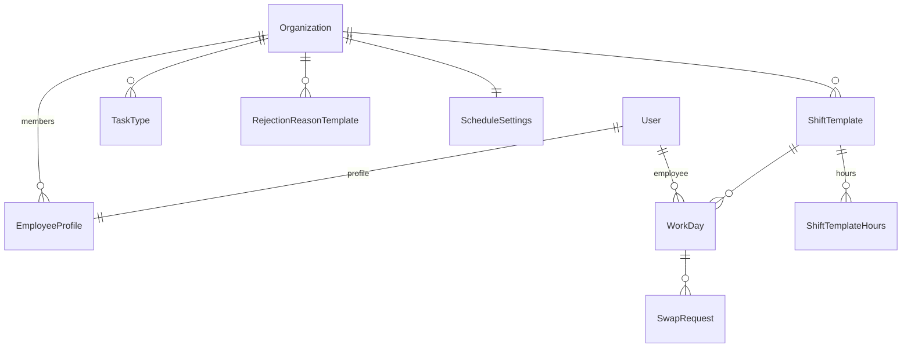

# ProstyGrafik

[](https://github.com/marcelwojdat/LighterSchedule/actions/workflows/ci.yml)

Aplikacja webowa do układania grafiku pracy zmianowej dla małych firm. Pracownicy deklarują dyspozycyjność
i wymieniają się zmianami, kierownik zatwierdza grafik, pilnuje obsady i pobiera raport wypłat.
Wiele firm korzysta z jednej instancji, a dane każdej z nich są od siebie odizolowane.

**Stack:** Django 6 · Django REST Framework · JWT · PostgreSQL · React 19 · Docker

---

## Funkcje

**Kierownik**
- zakłada firmę przy rejestracji i dodaje konta pracowników,
- definiuje szablony zmian (godziny per dzień tygodnia, limit osób na zmianie),
- zatwierdza, edytuje lub odrzuca deklaracje — pojedynczo albo hurtowo,
- zatwierdza zamiany zmian między pracownikami,
- widzi braki obsady na najbliższe dni, statystyki miesiąca i pobiera raport wypłat w PDF,
- ustawia tygodniowy termin składania deklaracji.

**Pracownik**
- deklaruje dni pracy w kalendarzu (wybierając szablon zmiany),
- kopiuje grafik z poprzedniego tygodnia lub miesiąca,
- proponuje zamianę zmiany koledze (jednostronną lub dwustronną),
- subskrybuje grafik w Google / Apple Calendar (iCal z podpisanym tokenem).

Powiadomienia e-mail informują o zatwierdzeniu, odrzuceniu i zamianach.

---

## Architektura



| Warstwa | Najważniejsze pliki |
|---|---|
| Modele | `core/models.py` |
| Izolacja firm | `core/tenancy.py` |
| Walidacja i reguły biznesowe | `core/serializers.py` |
| Endpointy API | `core/views.py`, `lighterschedule_backend/urls.py` |
| Logika pomocnicza | `core/utils.py` (braki obsady, termin deklaracji), `core/schedule_copy.py`, `core/ical.py` |
| Frontend | `lighterschedule_front/src/` (panel kierownika: `components/Manager.js`, pracownika: `components/Dashboard.js`) |

### Model danych



Przynależność do firmy ma **jedno źródło prawdy**: `EmployeeProfile.organization`. Obiekty należące do firmy
(szablony zmian, typy zadań, ustawienia) mają własny klucz `organization`. Wpisy grafiku (`WorkDay`) i zamiany
celowo go nie mają — firma wynika z pracownika, więc nie da się zapisać niespójnych danych.

### Izolacja danych między firmami

Kierownik firmy A nie może zobaczyć ani zmienić danych firmy B. Ochrona działa na trzech niezależnych warstwach:

| Warstwa | Mechanizm | Chroni przed |
|---|---|---|
| Zapytania | `OrganizationScopedMixin.get_queryset()` filtruje każdy ViewSet po firmie użytkownika | odczytem lub edycją cudzego obiektu po ID w adresie URL (zwraca 404, nie 403 — nie zdradza, że obiekt istnieje) |
| Tworzenie | `OrganizationOwnedMixin.perform_create()` ustawia firmę z konta, nigdy z danych żądania | podmianie pola `organization` w treści żądania |
| Relacje | `OrganizationPrimaryKeyRelatedField` akceptuje tylko obiekty własnej firmy | podaniu cudzego ID w treści żądania (np. roli lub pracownika innej firmy) |

Nowe endpointy są domyślnie zamknięte (`DEFAULT_PERMISSION_CLASSES = IsAuthenticated`), a izolację sprawdza
osobny zestaw testów (`core/tests/test_tenancy.py`), zweryfikowany testami mutacyjnymi — po wyłączeniu
filtrowania w mixinie testy faktycznie przestają przechodzić.

---

## Uruchomienie lokalne

Wymagania: Python 3.12+, Node.js 20+, PostgreSQL 14+.

### 1. Baza danych

Utwórz pustą bazę, np. w pgAdmin albo `psql`:

```sql
CREATE DATABASE lighterschedule_db;
```

### 2. Backend

```powershell
copy .env.example .env      # uzupełnij DB_PASSWORD; lokalnie zostaw DJANGO_DEBUG=True
python -m venv venv
venv\Scripts\activate
pip install -r requirements.txt
python manage.py migrate
python manage.py runserver
```

API: `http://127.0.0.1:8000/api/` · panel admina Django: `http://127.0.0.1:8000/admin/`.

> `DJANGO_DEBUG=True` jest potrzebne lokalnie — przy `False` Django przekierowuje ruch na HTTPS
> i wymaga produkcyjnego `DJANGO_SECRET_KEY`.

### 3. Frontend

```powershell
cd lighterschedule_front
copy .env.example .env      # REACT_APP_API_URL=http://127.0.0.1:8000/api
npm install
npm start
```

Aplikacja: `http://localhost:3000`.

### 4. Pierwsze kroki

1. Wejdź na **Załóż konto firmy** (`/register`) — powstaje firma, a Ty zostajesz jej kierownikiem.
2. W panelu kierownika dodaj szablony zmian (np. Poranna 6–14, Wieczorna 14–22) i konta pracowników.
3. Zaloguj się jako pracownik, zadeklaruj kilka dni, a potem zatwierdź je jako kierownik.

### Docker

```bash
cp .env.example .env    # ustaw DB_PASSWORD, DJANGO_SECRET_KEY, DJANGO_ALLOWED_HOSTS
docker compose up --build
```

Brak wymaganego sekretu przerywa start z czytelnym komunikatem. Wdrożenie na serwer (Nginx, HTTPS,
systemd): [DEPLOY.md](DEPLOY.md).

---

## Testy

```powershell
python manage.py test core                          # backend: 124 testy

cd lighterschedule_front
npx react-scripts test --watchAll=false             # frontend
```

| Plik | Zakres |
|---|---|
| `core/tests/test_tenancy.py` | rejestracja firmy, izolacja danych między firmami |
| `core/tests/test_workdays.py` | deklaracje, szablony, limity obsady, termin deklaracji, kopiowanie, eksport iCal |
| `core/tests/test_swaps_and_users.py` | zamiany zmian, zarządzanie kontami |
| `core/tests/test_reports.py` | statystyki, braki obsady, powiadomienia, PDF, e-maile |

Testy backendu korzystają z małych fabryk danych (`core/tests/factories.py`). Reguła terminu deklaracji
przyjmuje bieżący czas jako argument, dzięki czemu testuje się ją bez podmieniania zegara.

---

## API — najważniejsze endpointy

| Endpoint | Opis |
|---|---|
| `POST /api/register/` | rejestracja: nowa firma + kierownik |
| `POST /api/token/`, `POST /api/token/refresh/` | logowanie JWT |
| `GET/PATCH /api/me/` | profil zalogowanego użytkownika |
| `GET/POST /api/users/` | konta w firmie (tworzenie: kierownik) |
| `GET/POST /api/workdays/` | grafik i deklaracje |
| `POST /api/workdays/{id}/approve/`, `.../reject/` | decyzja kierownika |
| `POST /api/workdays/bulk-approve/` | zatwierdzanie hurtowe |
| `POST /api/workdays/copy/` | kopiowanie tygodnia / miesiąca |
| `GET /api/workdays/export.ics/` | eksport do kalendarza |
| `GET/POST /api/swaps/` + `accept/`, `reject/`, `approve/` | zamiany zmian |
| `GET /api/shift-templates/?date=RRRR-MM-DD` | szablony zmian z obsadą na dany dzień |
| `GET /api/schedule-holes/?days=7` | braki obsady |
| `GET /api/stats/?month=RRRR-MM`, `GET /api/stats/payroll.pdf?month=RRRR-MM` | statystyki i raport wypłat |

---

## Znane ograniczenia

- Kopiowanie grafiku przez kierownika nie sprawdza limitu osób na zmianie (zwykłe dodawanie wpisu sprawdza).
- Użytkownik należy do dokładnie jednej firmy.
- Konto `createsuperuser` służy do panelu `/admin` — nie ma profilu, więc nie zaloguje się do aplikacji,
  dopóki nie przypiszesz mu firmy w adminie.
- Regulamin i polityka prywatności to treści demonstracyjne.

---

## Struktura repozytorium

```
├── core/
│   ├── models.py, serializers.py, views.py
│   ├── tenancy.py            # izolacja danych między firmami
│   ├── utils.py, schedule_copy.py, ical.py, email_notify.py, approval.py, pdf_fonts.py
│   ├── migrations/
│   └── tests/                # fabryki danych + testy per obszar
├── lighterschedule_backend/  # settings, urls
├── lighterschedule_front/    # React (Create React App)
├── Dockerfile, docker-compose.yml
├── DEPLOY.md
└── .env.example
```
